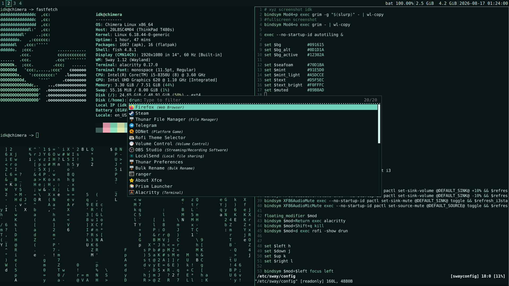
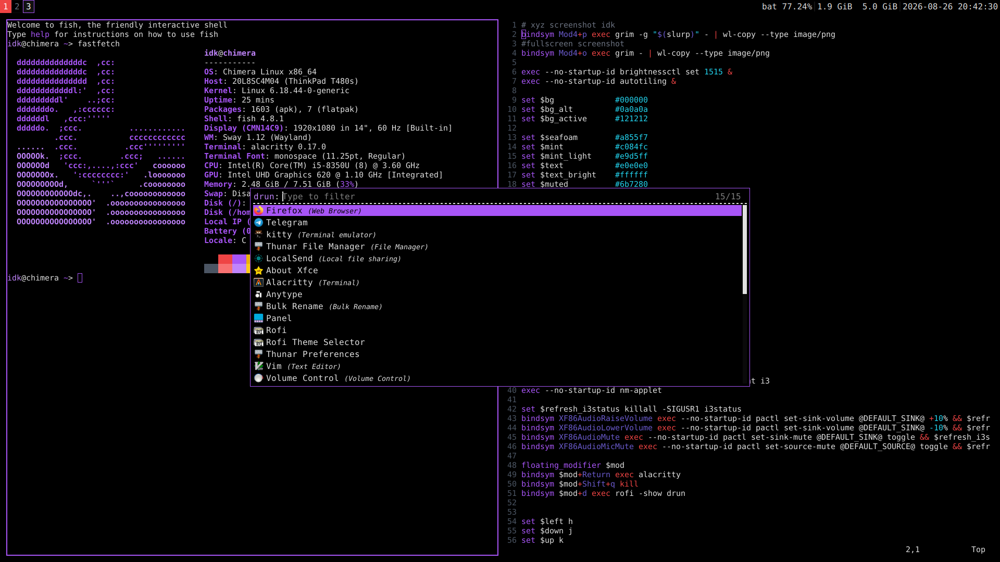

# kek its my dots btw larp larp sahur

<p align="center">
  
</p>

# larp sahur dots 2.0 (not finished yet)

<p align="center">
  
</p>

## put thisss shi here

* **vimrc** — `~/.vimrc`
* **alacritty.toml** — `~/.config/alacritty/alacritty.toml`
* **config.jsonc** — `~/.config/fastfetch/config.jsonc`
* **config.rasi** — `~/.config/rofi/config.rasi`
* **config** — `/etc/sway/config`
* **i3status.conf** — `/etc/i3status.conf`


## depedensnncncies 
```bash
doas apk add \
  sway alacritty rofi git \
  i3status autotiling vim  \
  grim slurp wl-clipboard xdg-desktop-portal-wlr \
```


## copy my shi wher you ned

```bash
# lmao
git clone https://github.com/Fkinaas-md/Dots
cd Dots

mkdir -p ~/.config/alacritty ~/.config/fastfetch ~/.config/rofi

 cp vimrc ~/.vimrc
 cp alacritty.toml ~/.config/alacritty/alacritty.toml
 cp config.jsonc ~/.config/fastfetch/config.jsonc
 cp config.rasi ~/.config/rofi/config.rasi

sudo cp config /etc/sway/config
sudo cp i3status.conf /etc/i3status.conf
```

```bash
# lmao 2.0
git clone https://github.com/Fkinaas-md/Dots
cd Dots/Larp2.0

mkdir -p ~/.config/alacritty ~/.config/fastfetch ~/.config/rofi

 cp vimrc ~/.vimrc
 cp alacritty.toml ~/.config/alacritty/alacritty.toml
 cp config.jsonc ~/.config/fastfetch/config.jsonc
 cp config.rasi ~/.config/rofi/config.rasi

sudo cp config /etc/sway/config
sudo cp i3status.conf /etc/i3status.conf
```
